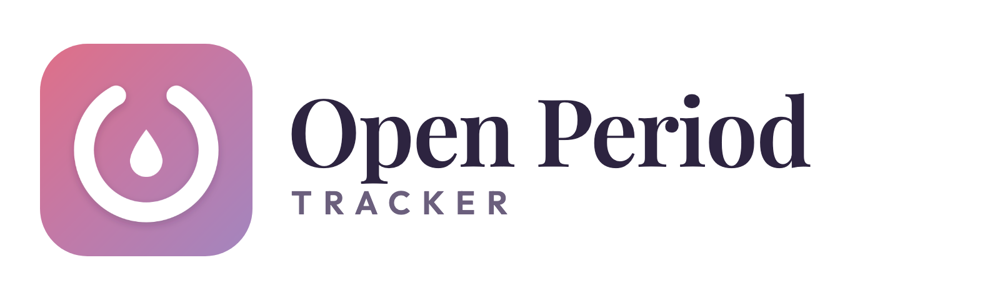
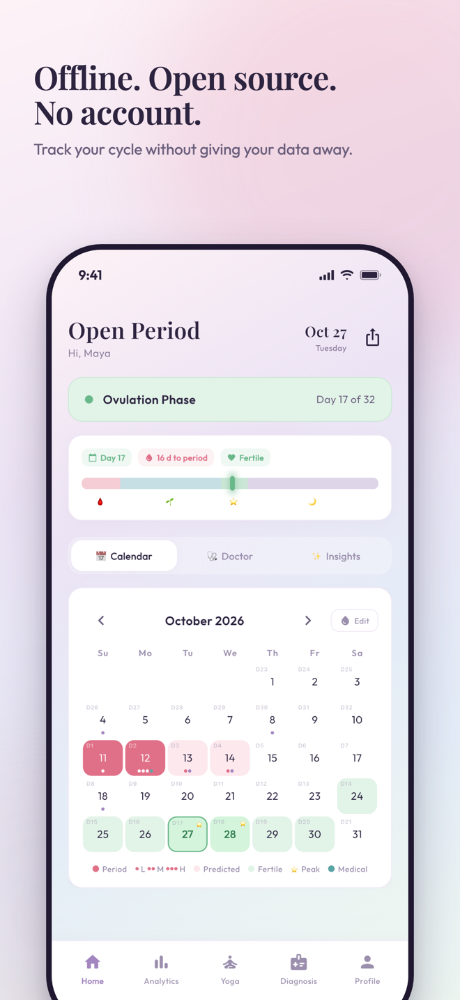
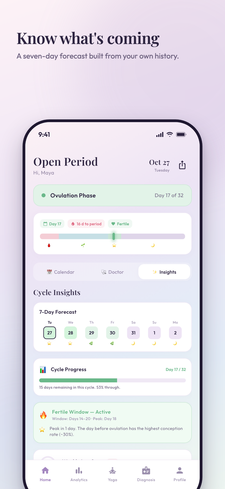
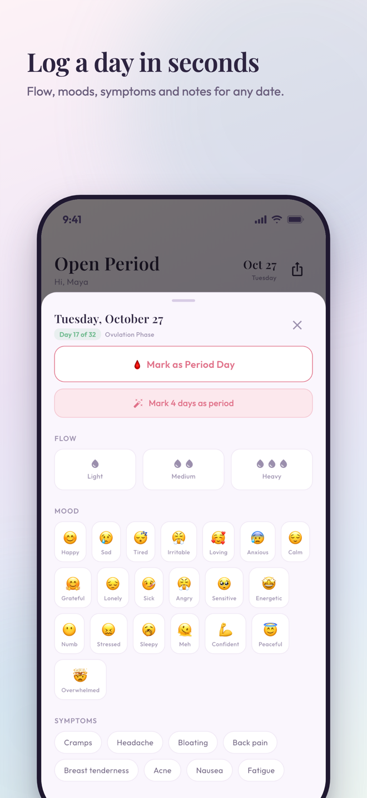
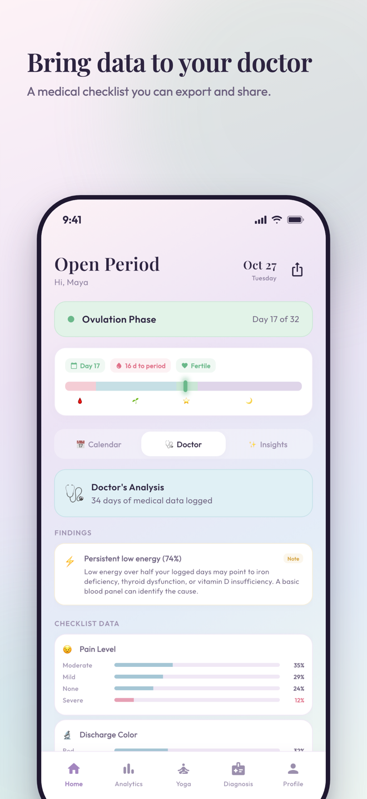
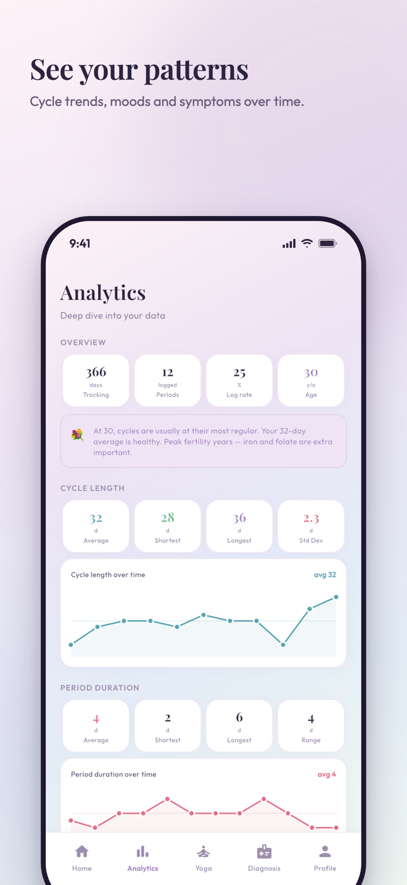
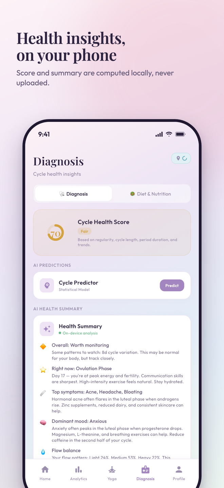
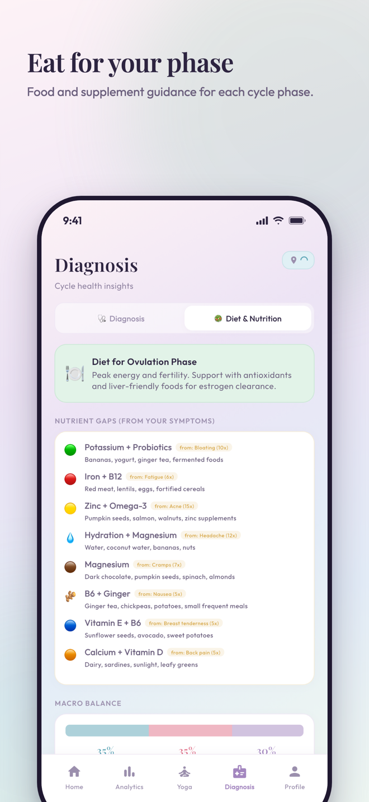
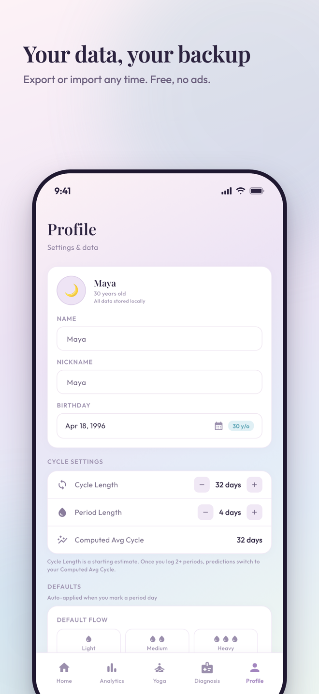

# Open Period Tracker



A free, open-source period and cycle tracker for iOS and Android. It works offline, needs no account, shows no ads, and keeps your data on your device.

- **App Store:** https://apps.apple.com/us/app/open-period-cycle-tracker/id6761253443
- **Google Play:** https://play.google.com/store/apps/details?id=com.brandbuilder.periodtracker
- **Website:** https://onepiece92.github.io/openPeriodTracker/
- **Privacy policy:** https://brandbuilder.com.np/privacy-policy-for-open-period-cycle-tracker/

Store title: *Open Period & Cycle Tracker*. Built by [Brand Builder](https://brandbuilder.com.np) with Flutter. MIT licensed.

---

## Screenshots

| | | | |
|---|---|---|---|
|  |  |  |  |
|  |  |  |  |

---

## What it does

**Track**
- Log periods and flow (light, medium, heavy) on a calendar
- Record moods (20 to choose from), symptoms and notes for any day
- Doctor's checklist: pain, discharge, skin, hair, sleep, libido, digestion, breast changes, energy, weight
- Period history and a comparison of the current cycle against your average

**Predict**
- Next period, fertile window and peak day on the calendar and home screen
- An on-device LSTM model (TensorFlow Lite) refines cycle length and period duration predictions from your own history
- 7-day phase forecast and symptom forecast from past cycles
- Optional reminders before a predicted period

**Understand**
- Insights: best and worst cycle days, weekly logging score, phase-based tips drawn from your own logs
- Analytics: cycle length trends, mood and symptom frequency, phase correlations
- Diet & Nutrition: phase-aware foods, macro and hydration guides, supplement suggestions, and regional food picks if you grant location access
- Yoga: poses and breathwork matched to each phase, with links to practice videos on YouTube
- AI prompt builder: generate an anonymised summary of your logs to paste into ChatGPT, Claude or Gemini

**Keep control**
- JSON backup and restore
- Demo data generator (one year of realistic data) to explore the app
- Three-step onboarding, skippable

---

## Privacy, stated plainly

- All data is stored in a local SQLite database on your device. The app runs no servers and collects nothing.
- No account, no cloud sync, no analytics SDK, no advertising SDK.
- The app does not encrypt the database itself. It relies on the operating system's protection of app data at rest.
- Network use is limited to three optional things: opening YouTube links from the Yoga tab, the operating system's geocoder to pick a food region (only if you grant location), and an Ollama server you configure yourself for local AI summaries.

Full policy: https://brandbuilder.com.np/privacy-policy-for-open-period-cycle-tracker/ (also in [PRIVACY_POLICY.md](PRIVACY_POLICY.md)).

---

## FAQ

**Does it work offline?**
Yes. Every feature runs on the device. Nothing requires a connection.

**Do I need an account?**
No. Open the app and start logging.

**What does it cost?**
Nothing. There is no subscription, premium tier, or in-app purchase.

**Can I export my data?**
Yes. Profile → Backup exports a JSON file you can keep anywhere and restore later.

**Where is the source code?**
Here: https://github.com/onepiece92/openPeriodTracker, under the MIT license.

**Is it medical advice?**
No. The app is a tracking and information tool. Talk to a healthcare professional about anything that concerns you.

---

## Tech stack

| Layer | Technology |
|-------|-----------|
| Framework | Flutter 3.x, Dart 3.x |
| State management | `provider` |
| Local database | `sqflite` (SQLite) |
| Routing | `go_router` |
| Prediction | `tflite_flutter` with a small LSTM model trained by `scripts/train_lstm_model.py` |
| Typography | Google Fonts (Playfair Display, Outfit) |

Architecture is feature-first: `lib/features/<feature>/` holds screens, `lib/core/` holds models, providers, database and theme.

---

## Getting started

Prerequisites: Flutter SDK 3.x, Xcode for iOS or Android Studio for Android.

```bash
git clone https://github.com/onepiece92/openPeriodTracker.git
cd openPeriodTracker
flutter pub get

flutter run -d ios      # iOS simulator
flutter run -d android  # Android emulator
flutter run -d chrome   # web
```

To regenerate the prediction model:

```bash
pip install tensorflow numpy
python scripts/train_lstm_model.py
```

Store metadata lives in `fastlane/metadata/`. The landing page lives in `docs/` and is served by GitHub Pages.

---

## Contributing

See [CONTRIBUTING.md](CONTRIBUTING.md). Contributions must keep the app offline-first and free of tracking. Security concerns: see [SECURITY.md](SECURITY.md).

## License

MIT. See [LICENSE](LICENSE).
